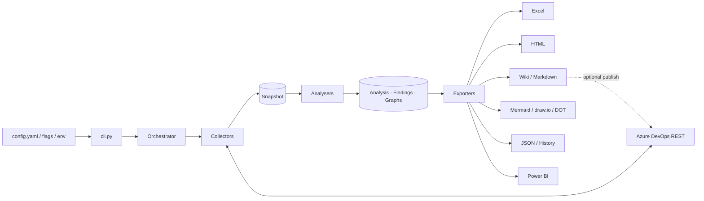

# Architecture



```text
src/azdo_analyser/
  core/          config, auth, REST client, models, plugin registry, run context, orchestrator
  collectors/    project, repositories, pipelines, releases, environments, agent_pools, library,
                 service_connections, boards, wiki, test_plans, artifacts, security (+ common helpers)
  analysers/     yaml_parser + yaml_analysis, pipeline_graphs, dependency_engine, hierarchy_graphs,
                 metrics, scoring, risk_engine, trends, summary
  visualisers/   mermaid, drawio (+ Graphviz DOT)
  exporters/     tables (shared flat tables), excel, html, markdown, wiki, docs_builder, json_export,
                 mermaid_export, powerbi
  templates/     report.html.j2
  demo.py        synthetic project served through a fake HTTP session
```

## Data flow

1. **Collectors** call the REST API and write *normalised* records into `assessment.snapshot[<section>]`
   (plain dicts/lists — JSON serialisable). Each collector owns one section and can read sections produced by
   collectors it `depends_on`.
2. **Analysers** read the snapshot and write to `assessment.analysis`, `assessment.graphs` (a renderer-neutral
   `Graph` of nodes/edges) and `assessment.findings` (`Finding` with severity, impact, recommendation,
   remediation steps).
3. **Exporters** render the assessment. Tabular exporters share `exporters/tables.py`, and the Markdown/Wiki
   exporters share `exporters/docs_builder.py`, so every output shows the same numbers.

## Plugins

Every collector, analyser and exporter registers itself:

```python
@register_collector("repositories", order=20, depends_on=("project",))
class RepositoryCollector(Collector): ...
```

The registry orders plugins by `order`, then topologically by `depends_on`. Third-party packages can add
plugins through the `azdo_analyser.plugins` entry-point group (see [extending.md](extending.md)).
`azdo-analyse --list-plugins` shows what is registered.

## Fault isolation and coverage

- Every API call in a collector goes through `ctx.safe(area, fn, default)`. Permission (401/403), not-found
  (404, e.g. a disabled feature) and other API errors are recorded as **coverage entries** and the collector
  continues. These appear in the *Coverage* sheet and the *Data Coverage* page.
- A plugin that raises is recorded as failed; the run continues. Only the `project` collector is `fatal`.
- Each risk rule runs in isolation; a broken rule is reported in coverage and the other rules still run.

## REST client

`core/client.py` talks to the REST API directly (via `requests`) rather than the `azure-devops` Python SDK. The
SDK does not cover several APIs this tool depends on (environments & checks, pipeline permissions, audit log,
user entitlements, wiki page batches, pipeline preview) and its generated clients trail the REST surface. The
client handles service hosts (`dev.azure.com`, `vsrm.`, `vssps.`, `feeds.`, `vsaex.`, `auditservice.`; legacy
`*.visualstudio.com`; Azure DevOps Server's single host), continuation-token and `$top/$skip` paging, retries with
`Retry-After` for throttling and 5xx, and typed errors.

## YAML analysis

`yaml_parser.py` parses Azure Pipelines YAML statically. Template expressions (`${{ if }}`, `${{ each }}`,
`${{ else }}`) are *flattened as the union of all branches*, which is the right answer for dependency analysis:
everything a pipeline *could* use is reported. `${{ parameters.x }}` values are substituted from template
defaults and the parameters passed at each inclusion, so a deployment template included once per stage resolves
to each stage's service connection and environment. Templates are resolved across repositories through
`resources.repositories` aliases (relative paths, `@alias`, `@self`), recursively with cycle protection; the
stage-flow model expands stage, job and `extends` templates.

For full fidelity (runtime expressions, `each` loops over objects), enable `expand_yaml_via_preview`: the
pipeline preview API returns the server-side expanded YAML, which then drives the stage flow and service
connection list.

## Scores

- **Risk score** (0–100, higher = riskier): findings weighted by severity (`CRITICAL 25, HIGH 10, MEDIUM 4,
  LOW 1`) and category (security and deployment weigh most), passed through a saturating curve
  `100·(1−e^(−points/120))` (50 points ≈ 34, 120 ≈ 63, 250 ≈ 88). Grades: A < 15 ≤ B < 35 ≤ C < 55 ≤ D < 75 ≤ F.
- **Technical debt** (0–100): classic pipelines/releases share, anti-patterns, failing and idle pipelines,
  stale repositories, highly complex pipelines and broken documentation.
- **Pipeline complexity**: weighted count of stages, jobs, steps, templates, nesting depth, parameters,
  conditions, service connections, environments and variables; banded Low/Medium/High/Very high.
- **Cost estimate**: peak observed concurrency on hosted and self-hosted pools (first parallel job free) and
  hosted minutes per month. Prices are configurable; agent VM costs are not included.
